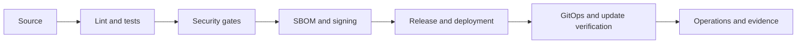

# Bastion Pipeline

This repository is a hardened pipeline demo that covers application security, supply-chain checks, deployment automation and Windows packaging.

## Pipeline view

## Stage to tool map

| Stage | Tools |
| --- | --- |
| App quality | pytest, ruff, mypy |
| Windows packaging | PSScriptAnalyzer, Pester, zip, SHA256SUMS |
| Container hardening | Docker, hadolint, Trivy |
| CI | GitHub Actions, GitLab CI, Jenkins |
| SAST and SCA | Semgrep, SonarCloud, Gitleaks, OSV-Scanner, Dependency-Check |
| DAST | ZAP |
| Provenance and signing | cosign, Syft, Sigstore |
| GitOps | ArgoCD, kustomize, kubeconform |
| Update security | SoftHSM2, PKCS#11, pytest |

## Results table

| Check | Status | Notes |
| --- | --- | --- |
| App regression tests | Verified | `python -m pytest app/test_main.py -q` passed |
| Workflow YAML validation | Verified | Parses successfully with PyYAML |
| Repo style gate | Verified | `scripts/check-style.ps1` passed |
| Dependency findings | Planned | Fresh CI run required for full security scan |
| Image size | Planned | Fresh container build required |
| Hardening delta | Planned | Fresh Trivy run required |
| Release verification | Planned | Fresh tag run required |

## Quick start

1. Clone the repository.
2. Open the repo in a shell.
3. Run pwsh -File scripts/check-style.ps1.
4. Run the local app checks in app/.
5. Run the Windows packaging checks in windows/.
6. Review the release and GitOps documentation in docs/.

## Repository status

The repository now includes the verified local app, hook, and pipeline guardrails. The stack is ready for CI execution and the remaining items are operational checks that require a fresh GitHub, GitLab, or Jenkins run rather than local code changes.
