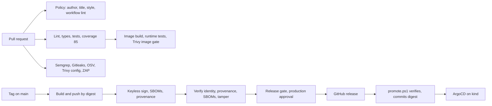

# Bastion Pipeline

A secure software delivery pipeline you can clone, run and break on purpose. The payload is small (a FastAPI notes service and a Windows package). The pipeline is the product: hash-locked builds, a hardened container, scanning gates, SBOMs, keyless signing, provenance verification, a release gate, GitOps deployment and signed updates.

The goal is evidence. Every claim below names a command or a run and a result. Status words follow [the glossary](docs/GLOSSARY.md): PASS, FAIL, NOT VERIFIED, PLANNED, NOT APPLICABLE.

## At a glance

- Two signed releases, [v0.2.0](https://github.com/siiick-brain/Bastion-Pipeline/releases/tag/v0.2.0) and [v0.2.1](https://github.com/siiick-brain/Bastion-Pipeline/releases/tag/v0.2.1), each verified again outside CI with [the verify guide](docs/verify.md).
- Every change reaches `main` through a pull request that must pass 9 required checks. Five open [gate demo](docs/gate-demos.md) pull requests show each gate blocking a bad change.
- ArgoCD deployed `v0.2.1` and a `git revert` pull request rolled it back to `v0.2.0` ([GitOps](docs/gitops.md)).
- Every requirement maps to a test and evidence in the [control matrix](docs/control-matrix.md).


## What it demonstrates

- Rejecting an untrusted artifact: a wrong signer, a wrong issuer, a tampered blob, a modified provenance claim and an unsigned image are each refused by a test you can run.
- Verifying origin, not just a signature: digest, certificate identity, issuer, workflow, ref, commit and runner.
- Verifying the running system, not configuration files: container and pod checks read `/proc` from the live process.
- One pipeline contract across GitHub Actions, GitLab CI and Jenkins, with the gaps stated.

## What it does not demonstrate

No cloud account, no production cluster, no real HSM and no real secure boot. SoftHSM and the firmware simulator are labelled as software. See [known limitations](docs/known-limitations.md).

## Pipeline



Details: [architecture](docs/architecture.md), [threat model](docs/threat-model.md), [pipeline contract](docs/pipeline-contract.md), [control matrix](docs/control-matrix.md).

## Stages and tools

| Stage | Tools | Gate |
| --- | --- | --- |
| Source policy | commit-msg hook, `check-authorship.sh`, `check-style.ps1` | PR |
| Lint and types | ruff, mypy strict, yamllint, actionlint, zizmor, shellcheck, hadolint, PSScriptAnalyzer | PR |
| Tests | pytest with Hypothesis (coverage at least 85), Pester | PR, release |
| Container | multi-stage Chainguard image, runtime tests, Trivy | PR, release |
| SAST, secrets, SCA, IaC | Semgrep, Gitleaks, OSV-Scanner, dependency review, Trivy config, kubeconform | PR |
| DAST | ZAP baseline (PR), ZAP full (weekly) | PR |
| Supply chain | Syft (CycloneDX 1.6, SPDX 2.3), cosign keyless, GitHub provenance | Release |
| Release | `gate.py` in the `production` environment | Release |
| Deployment | kustomize, ArgoCD, `promote.ps1`, `verify-deployment.ps1` | Promotion |
| Updates | SoftHSM2 PKCS#11 signing, anti-rollback, firmware simulation | Container job |

Which tool owns which finding: [tool ownership](docs/tool-ownership.md).

## Results from real runs

Hosted runs on GitHub on 2026-11-16 and 2026-11-17, local runs on Windows 11 with Docker Desktop 29.9.

| Check | Where | Result |
| --- | --- | --- |
| Pull request gates (ci, security, windows) | GitHub, every pull request | PASS: 14 checks, 9 of them required |
| Python tests and coverage | `pytest --cov` in the release | PASS: 264 tests, 94.22 percent |
| SonarCloud quality gate | GitHub `security` workflow | PASS: security, reliability and maintainability A, 0 vulnerabilities |
| Release `v0.2.1` | GitHub release run 44092986387 | PASS: signed by digest, SBOMs, provenance, gate ALLOWED after the `production` approval |
| Independent release verification | [verify guide](docs/verify.md), run outside CI | PASS: signature, attestations, provenance policy; tampered checksums and a wrong signer rejected |
| Real OIDC token policy | GitHub `oidc-demo` runs 43815627785 and 44045166737 | PASS: accepted on `main`, rejected for the wrong audience and for another branch |
| Deployment, drift and rollback | kind with ArgoCD | PASS: 8 checks, drift healed, rollback by revert ([report](docs/deployment-verification.md)) |
| Image vulnerabilities, naive versus hardened | `trivy image` 0.76.2 | 15 critical and 491 high versus 0 and 0 ([hardening](docs/hardening.md)) |
| Signed update suite in SoftHSM container | `update-signing/run-demo.sh` | PASS: 55 tests, counter persists across runs |
| Jenkins pipeline, isolated agent | `infra/jenkins/run_job.py` | PASS: build 9 |
| GitLab CI | GitLab pipeline 3083481172 | PASS: 8 jobs, same source stages as GitHub |

## Quick start

```powershell
git clone https://github.com/siiick-brain/Bastion-Pipeline.git
cd Bastion-Pipeline
git config core.hooksPath scripts/hooks
python -m venv .venv
.venv/Scripts/python -m pip install --require-hashes --no-deps --only-binary :all: -r app/requirements-dev.txt
pwsh -File scripts/validate-pipeline.ps1
```

Prerequisites and every other command: [operations](docs/operations.md).

## Break it on purpose

| Try this | Expected |
| --- | --- |
| `pytest scripts/release/test_verify_provenance.py -v` | Ten tampered provenance cases rejected |
| `pytest tests/integration/test_supply_chain.py -m network -v` | Wrong workflow, ref, issuer and repository rejected by cosign against real Sigstore data |
| `pwsh -File scripts/kind-demo.ps1` | An unsigned image is refused before deployment |
| Two runs of the SoftHSM container | A downgrade is refused after a container restart |
| `pwsh -File scripts/make-gate-demos.ps1`, push a branch, open a PR | A secret, a vulnerable dependency, a failing test, an unpinned action or a root container turns a check red (see the open pull requests 18 to 22) |

## Verify a release

[docs/verify.md](docs/verify.md) lists every command and a tamper that fails.

## Documentation

[Documentation index](docs/README.md) and [roadmap](docs/roadmap.md).
