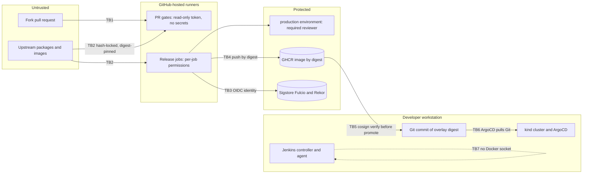
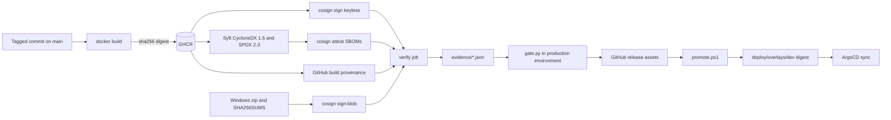

# Architecture

Bastion Pipeline is a secure software delivery pipeline. The payload is deliberately small: a FastAPI notes service (`app/`) and a Windows package (`windows/`). The pipeline that builds, checks, signs, releases and deploys them is the product.

## Components and responsibilities

| Component | Location | Responsibility | Runs where |
| --- | --- | --- | --- |
| Notes service | `app/` | Payload. Health endpoint, in-memory CRUD, strict input validation, security headers. | Container |
| Windows tooling | `windows/` | Lint, Pester tests, zip package, SHA256SUMS. | GitHub `windows-2025` runner, local Windows |
| Pull request gates | `.github/workflows/ci.yml`, `security.yml`, `windows.yml` | Block merges on policy, lint, test, container, IaC, SAST, secret and SCA failures. | GitHub-hosted runners |
| Release workflow | `.github/workflows/release.yml` | Build, push by digest, keyless signing, SBOMs, provenance, verification, gate, publish. | GitHub-hosted runners |
| Release gate | `scripts/release/gate.py` | Evaluates evidence files and blocks the release unless every mandatory control is PASS. | Release `gate` job in the `production` environment |
| Verifiers | `scripts/release/verify_provenance.py`, `sbom_check.py`, `scripts/verify-release.sh` | Check what was signed, who signed it and which build produced it. | Release `verify` job, local |
| OIDC verifier | `scripts/oidc/verifier.py` | Validates a GitHub OIDC token like a cloud trust policy would. | `oidc-demo.yml`, local tests |
| Deployment | `deploy/`, `infra/kind`, `infra/argocd`, `scripts/promote.ps1` | Kustomize overlays, local cluster, GitOps sync, signature check before promotion. | Local kind cluster |
| GitLab CI | `.gitlab-ci.yml` | Second CI platform for the source stages. | GitLab shared runners |
| Jenkins | `Jenkinsfile`, `infra/jenkins/` | Third CI platform for the source stages, with an isolated agent. | Local Docker Compose |
| Update signing | `update-signing/` | Signed update packages through PKCS#11 (SoftHSM2), anti-rollback, atomic install. | Container |
| Firmware simulation | `firmware-sim/` | Models secure boot decisions. Simulation only. | Python |

## Trust boundaries

| Boundary | Crossing | Enforcement point |
| --- | --- | --- |
| TB1 | Pull request code enters CI | `pull_request` trigger only, `permissions: {}` at workflow level, read-only job tokens, `persist-credentials: false`, no secrets, SARIF upload skipped for forks. |
| TB2 | Third-party code enters builds | `--require-hashes` lock files, base images and tool images pinned by digest, actions pinned by commit SHA, Dependabot 7-day cooldown, OSV-Scanner gate. |
| TB3 | Release job obtains a signing identity | `id-token: write` only on `build` and `sign-windows`. The certificate identity is the exact release workflow and tag. |
| TB4 | Artifact leaves CI | Pushed by digest. Every later step refers to the digest, never a tag. |
| TB5 | Release enters deployment | `scripts/promote.ps1` refuses tags and refuses any digest that fails cosign identity verification. |
| TB6 | Git state enters the cluster | ArgoCD applies only committed state. Pod Security Admission `restricted` rejects non-compliant pods. |
| TB7 | Jenkins builds run code | Builds run only on the agent. The controller has zero executors. No container mounts the Docker socket. |

## Artifact flow

## Identity flows

- **Release signing.** The `build` job requests a GitHub OIDC token. Fulcio issues a short-lived certificate whose subject is `https://github.com/siiick-brain/Bastion-Pipeline/.github/workflows/release.yml@refs/tags/<tag>`. Rekor logs the signature. No private key is stored.
- **OIDC demonstration.** `oidc-demo.yml` requests a token with audience `bastion-pipeline-demo`. `scripts/oidc/verifier.py` checks it against `scripts/oidc/policy.toml`. No cloud account is involved.
- **Registry.** GHCR access uses the job's `GITHUB_TOKEN` with `packages: write` only in `build`.
- **Jenkins agent.** The controller reaches the agent over SSH with an Ed25519 key generated per setup and stored in a gitignored secrets folder.

## External services

| Service | Used by | Data sent |
| --- | --- | --- |
| GitHub Actions, GHCR, code scanning | All workflows | Source, images, SARIF |
| Sigstore Fulcio and Rekor (public) | `release.yml` | Artifact digests and the signing certificate. Rekor entries are public. |
| OSV.dev | OSV-Scanner | Package names and versions |
| SonarCloud | `security.yml` when `SONAR_TOKEN` is set | Source code |
| NVD | Dependency-Check (scheduled) | Package identifiers |
| GitLab | `.gitlab-ci.yml` when the second remote is configured | Source |

## Local-only components

kind cluster, local registry on `127.0.0.1:5001`, ArgoCD, Jenkins controller and agent, SoftHSM2 container, ZAP scans. None publish ports beyond `127.0.0.1`.

## Deployment boundary

The only deployment target is the local kind cluster. There is no cloud account. ArgoCD reads `deploy/overlays/dev` from the GitHub repository. Signature verification happens before promotion (in `promote.ps1`). On a cluster set up with `kind-up.ps1 -WithAdmission`, Kyverno verifies it again at admission time ([ADR 0006](adr/0006-admission-signature-policy.md)).
