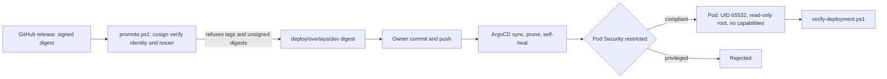

# Deployment

## Verification

`scripts/verify-deployment.ps1` checks the running state, not the manifests. It writes [deployment verification](deployment-verification.md):

1. The running pod's `imageID` digest equals the overlay digest.
2. cosign verification of that digest passes.
3. Inside the pod, `/proc/1/status` shows UID 65532, `CapEff` zero and `NoNewPrivs` 1. A write to `/srv/app` returns `EROFS`.
4. A server-side dry run of a privileged pod is rejected by Pod Security Admission.
5. The ArgoCD Application is Synced and Healthy.
6. A manual `kubectl scale` is reverted by self-heal.

## Limits

- Local kind cluster only. No cloud account.
- No admission-time signature enforcement (PLANNED).
- `localhost:5001` is a plain HTTP registry used only on the workstation.
